# Chapter 12 学習ノート：創造性をコンセプト生成に適用する

原題：**Applying Creativity to Generating a Concept**  
対象書籍：『System Architecture: Strategy and Product Development for Complex Systems』  
用途：自習・輪読発表の準備  
対応資料：[輪読発表レジュメ](chapter12-reading-group.md)

> **この章の主張：** 目標を満たす実現方法を複数生み出し、機能ごとの案を組み替え、比較できる少数の全体案へ育てる。

提供画像24枚に基づく要約・解説。原著の節番号・図表番号・ページを併記した。「補足」「解釈」「演習」は本資料で加えた説明を表す。自動車の分類・性能値・市場予測は原著当時のものとして読む。図表は提供画像から切り出し、原図のキャプションと出典表記を含めて掲載した。画像を押すと切り出し画像を開ける。

**読む順番：** 初読は1〜9節で章の筋を追い、10節以降を用語確認・復習・原文照合に使う。発表準備を急ぐ場合は、[概要](#overview) → [4ステップと事例の対応](#four-steps) → [統合](#integrate) → [選別](#select)の順に読む。

## 目次

1. [この章を3分でつかむ](#overview)
2. [12.1・12.2：創造性とコンセプト](#creativity)
3. [コンセプト生成の4ステップ](#four-steps)
4. [12.3：全体コンセプトをつくる](#develop)
5. [12.4：分解し、コンセプト断片をつくる](#fragments)
6. [12.5：断片から統合コンセプトをつくる](#integrate)
7. [12.6：少数の候補を選ぶ](#select)
8. [12.7：章全体のまとめ](#summary)
9. [Box 12.2：自動車産業のアーキテクチャ競争](#competition)
10. [用語集](#glossary)
11. [図表の読み解き一覧](#figures)
12. [理解確認と解答](#questions)
13. [自分の仕事に適用するワークシート](#worksheet)
14. [読解上の注意・原資料索引](#sources)

<a id="overview"></a>

## 1. この章を3分でつかむ

### 中心となる問い

**ステークホルダーのニーズと目標から、どのように複数のシステムコンセプトを生み出し、次の設計へ進める候補を選ぶか。**

本章は、前後の活動との関係を次のように位置づける。第11章までに「何のためにつくるのか」を明確にし、第12章で「どのような原理・実現手段で成り立たせるか」を複数のアイデアにする。第13章以降では、それらをアーキテクチャへ具体化し、複雑性を管理する。〔12.1、pp.276–277〕

### 持ち帰りたい5点

1. **コンセプトは機能と形態の対応づけである。** 「何をするか」と「何によって実現するか」を結びつける。
2. **意図的に候補を増やす。** アイデアの生成と評価を分け、早い段階でひとつの案に固定しない。
3. **構造化した発想も創造性である。** 分解、再結合、候補の一覧化が発想を助ける。自由な連想も併用する。
4. **断片の組み合わせには制約と相互作用がある。** 良い部分案を集めるだけでは、良い全体案になるとは限らない。
5. **目標への適合と、良いアーキテクチャへ育つ可能性の両方で選ぶ。** 本章は、さらに検討する2〜3案を出口として示す。〔12.2、12.5–12.7〕

ハイブリッド車の分類を覚えるだけでなく、各分類が「どんな分解と組合せから生まれ、何を基準に比べられるか」を追うと、他のシステムにも応用できる。

### 章全体の位置づけ

<a id="figure12-01"></a>

[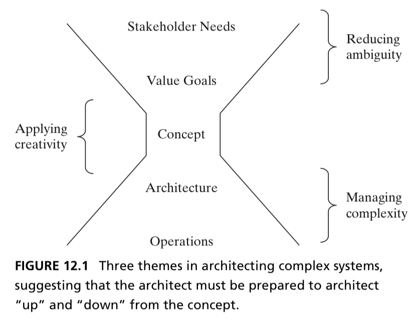](assets/chapter12/figure12-01.png)

**図12.1｜複雑なシステムのアーキテクティングをつなぐ3つの主題。** 出典：[原著p.277](../ref/IMG_0042.png)。

コンセプトは多数のニーズを集約し、後の詳細設計を方向づける簡潔な表現になる。アーキテクトは上流の目標にも下流の実現可能性にも働きかける必要がある。単純な一方向の工程を意味しない。〔12.1、図12.1、pp.276–277〕

<a id="creativity"></a>

## 2. 12.1・12.2：創造性とコンセプト

参照：[p.277](../ref/IMG_0042.png)／[p.278](../ref/IMG_0043.png)／[p.279](../ref/IMG_0044.png)／[p.280](../ref/IMG_0045.png)／[p.281](../ref/IMG_0046.png)

### 2.1 著者のいう創造性

著者は創造性について、次の立場を取る。

| 観点 | 本章の立場 | 読み取れること |
| --- | --- | --- |
| 新規性 | それまで知られていない新しい出力を伴う | 既存案の列挙だけで終わらせない |
| 意図 | 創造性には意図が必要 | 努力を意図的に向ける。手順が線形・明確である必要はない |
| 影響・成果 | 創造性の定義に含めない | 影響や有効性の評価は発想の後に行う |

発想中は新しい可能性を広げ、案を比較する段階で有効性を評価する。図12.2も、候補をいったん増やし、その後に目標への適合で絞る姿を示す。

<a id="figure12-02"></a>

[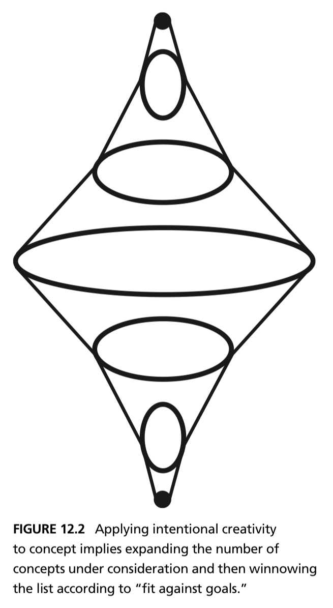](assets/chapter12/figure12-02.png)

**図12.2｜コンセプト候補を広げ、目標への適合で絞る。** 出典：[原著p.278](../ref/IMG_0043.png)。

### 2.2 非構造化の創造性と構造化された創造性

| 方法 | 発想の起点 | 本章で紹介される例 | 留意点 |
| --- | --- | --- | --- |
| 非構造化の創造性 | 連想、ひらめき、既存の思考経路からの脱出 | ブレインストーミング、自由連想、無作為な単語と問題を関連づける | 方法や過程を厳密に規定しにくい |
| 構造化された創造性 | 問題の分析や分解、選択肢の枠組み | 要素の再結合、網羅性を促す一覧、形態マトリクス、Six Hats、TRIZ | 枠組みに入れた候補だけで探索を終えないことが大切 |

著者は両方を必要とする。分析で生まれたアイデアも創造的であり、ひらめきだけを創造性と呼ぶ立場は、創造性を意図的に促すうえで有用でないと考える。

### 2.3 構造化された発想の具体例

**解決手段に依存しない問い直し。** 第7章の例として、「コルクを抜く」より「ワインにアクセスする」の方が広い候補を生むことが紹介される。前者はコルクを取り除く手段に探索を寄せるが、後者は必要な価値に立ち返る。

問いを広げる際には、企業の中核能力や意図する事業範囲に収まる抽象度を選ぶ。12.1は、発想の自由度と探索範囲の両方を考慮して問題を置くことを前提としている。

**要素の再結合。** 複数の機能に分解し、それぞれについて実現手段を挙げて組み合わせる。図12.3では、持ち上げる・支える（lifting）、推進する、進路を制御する各機能に、車輪、プロペラ、翼、ジェット、舵などの候補を置く。

<a id="figure12-03"></a>

[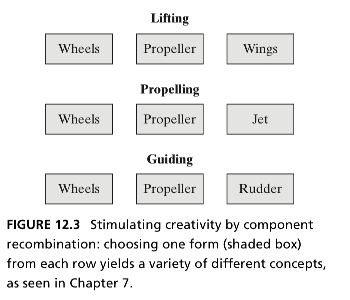](assets/chapter12/figure12-03.png)

**図12.3｜機能ごとの形態候補を再結合して発想する。** 出典：[原著p.279](../ref/IMG_0044.png)。

**網羅性を促す枠組み。** たとえばエネルギーの形態を並べ、化学エネルギーだけでなく回転エネルギーを使う案も考える。車載エネルギー貯蔵を電池に固定せず、フライホイールへ広げる例がある。「網羅性」は発想を促す狙いであり、一覧に載せれば全解空間を保証できるという意味ではない。

**Six Hats（6つの帽子）。** チーム内で情報、感情、吟味、楽観的評価などの異なる観点を担い、問題を多面的に考える。発想の枠組みは、技術要素の一覧に限らず、考える視点にも適用できる。

**TRIZ（発明的問題解決理論）。** 目標間の矛盾を出発点に、発明原理を使って新しい概念を得る方法として紹介される。たとえば、列車を速くするため出力を上げるとエンジンが重くなるという緊張に対して、別の動作原理を探す。得られた案が重量などの目標を満たすかは、その後の検証で確かめる。

### 2.4 コンセプトとは何か

本章では、コンセプトを**機能を形態に対応づけるビジョン・アイデア・心的な像**として捉える。作動の原理と、抽象化された実現手段を含む。〔12.2、図12.4、p.280〕

<a id="figure12-04"></a>

[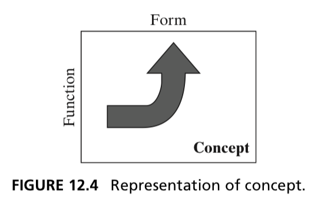](assets/chapter12/figure12-04.png)

**図12.4｜コンセプトは機能と形態の対応づけ。** 出典：[原著p.280](../ref/IMG_0045.png)。

| 区分 | 問い | 自動車での説明例 |
| --- | --- | --- |
| 目標・属性 | どのような良さを求めるか | 安価、環境負荷が小さい、燃費が良い |
| 機能 | 何をするか | 人と荷物を運ぶ、車両を動かす、減速する |
| 形態 | 何によって実現するか | 車両、内燃機関、電池、モーター |
| コンセプト | 機能をどの形態・原理で実現するか | モーターを発電動作させ、減速時のエネルギーを電池へ回収する |
| アーキテクチャ | 実装に向け、要素と関係をどう構成するか | 機器の構成、接続、機能の割当て、制御の分担を具体化する |

最後の列は理解のための説明例。コンセプトを説明するときは、**「何に、どんな変化を、何によって起こすか」**まで言葉にする。「燃費が良い」という目標や「モーター」という部品名を、作用と手段の関係へ具体化する。

コンセプトとアーキテクチャはつながっているが、本章は前者をアイデアを扱う言葉、後者を実装を扱う言葉として区別する。コンセプトはシステムへの部分的な答えであり、詳細設計の完成を意味しない。

<a id="four-steps"></a>

## 3. コンセプト生成の4ステップ

参照：[p.281](../ref/IMG_0046.png)・[p.282](../ref/IMG_0047.png)。以下の4ステップが12.3〜12.6に対応する。

入力はSPS（System Problem Statement：システム問題記述）と、システムに求める目標である。

**原著の4ステップ（pp.281–282の本文から切り出し）。**

<a id="steps-p281"></a>

[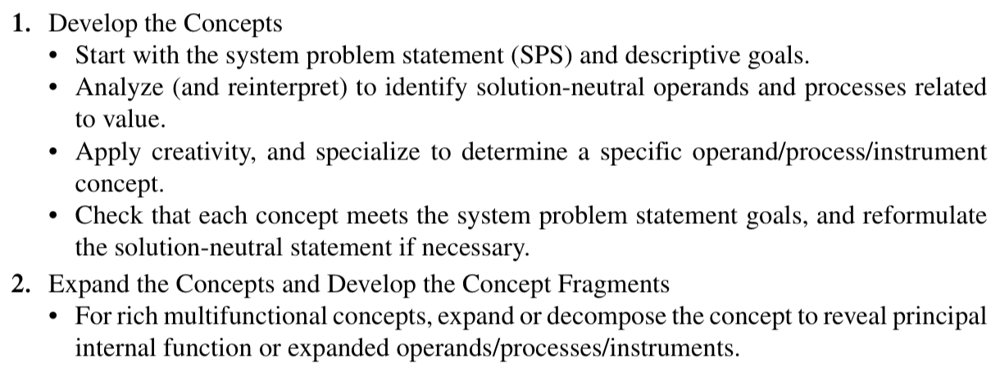](assets/chapter12/steps-p281.png)

**手順1・2前半｜全体コンセプトの生成と分解。** 出典：[原著p.281](../ref/IMG_0046.png)。

<a id="steps-p282"></a>

[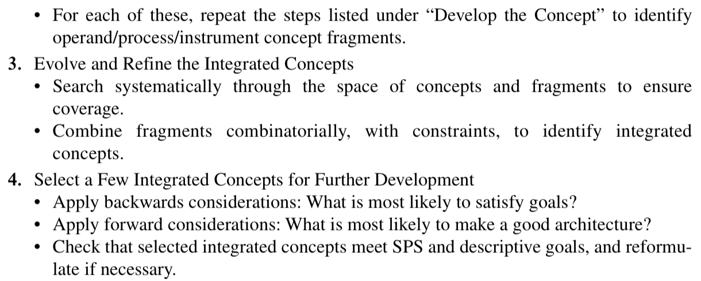](assets/chapter12/steps-p282.png)

**手順2後半・3・4｜断片の生成、統合、選別。** 出典：[原著p.282](../ref/IMG_0047.png)。

問題記述から候補をつくり、分解と再結合で探索を広げ、その後に選別する。原著のチェック項目には、問題記述や目標に戻って見直すことも含まれる。

| ステップ | 主な作業 | 得たい出力 | 確認すべき問い |
| --- | --- | --- | --- |
| 1. Develop | SPSと目標から、価値に関わる対象・作用を捉え、具体的な対象・作用・手段へ特殊化する | 全体コンセプト候補 | 問題を解いているか。手段を先に固定していないか |
| 2. Expand | 多機能なコンセプトを展開・分解し、各内部機能について再び発想する | コンセプト断片と候補群 | 内部では何が必要か。各機能を別の手段で実現できないか |
| 3. Evolve and Refine | 断片を体系的に探索し、制約の下で組み合わせる | 複数の統合コンセプト | 断片同士の競合・相乗効果は何か |
| 4. Select | 目標適合と、良いアーキテクチャへ育つ可能性を評価する | さらに開発する少数案 | 優先目標に合うか。構成・開発・製造が成立しそうか |

### ハイブリッド車の事例で4ステップをつなぐ

| ステップ | 本章の事例で行うこと | 次へ渡すもの |
| --- | --- | --- |
| 1. 全体案をつくる | 人と荷物を運ぶ価値から、ガソリン／電気のハイブリッド車という構想へ具体化する | 詳細な駆動構成が未定の全体案 |
| 2. 分解して断片をつくる | 推進をエネルギーの貯蔵・運搬と車両の駆動へ展開し、回生やブーストなども検討する | 機能ごとの実現原理・手段の候補 |
| 3. 統合案をつくる | シリーズ・パラレルなどの経路と内部機能を組み合わせ、車両全体の候補群を整理する | 構成と作動の違いを説明できる複数案 |
| 4. 少数案を選ぶ | 環境面、燃費、価格などの目標と、構成のまとまりの良さで比較する | さらに詳細化する候補と、その選別理由 |

この表は章内の説明をつないだもの。事例ではステップ1の途中までを前章から引き継ぎ、ステップ3では代表的な統合結果を示す。表12.1は比較の例であり、最終採用案までは示していない。

**補足：** 探索の途中では、候補そのものに加えて「比較すべき問い」も変わる。全体案の段階では何を組み合わせるかを問い、分解後は各機能の実現手段を問い、統合後は接続と相互作用を問う。

<a id="develop"></a>

## 4. 12.3：全体コンセプトをつくる

参照：[p.282](../ref/IMG_0047.png)／[p.283冒頭](../ref/IMG_0048.png)

### 4.1 価値から実現手段へ具体化する

ハイブリッド車の事例では、出発点は「人とその所有物の位置を変える」という解決手段に依存しない機能であり、「安価に」「環境に配慮して」という属性が付く。

本章が示すシステム問題記述（SPS）を、To–By–Usingの構造で要約すると次のようになる。

| 層 | 内容の要約 | 何を表すか |
| --- | --- | --- |
| To | 顧客とその所有物を、安価で環境に配慮した方法で運ぶ | 達成したい価値・目的 |
| By | 顧客自身が、同乗者や軽い荷物とともに、良好な燃費と操縦性で運転できるようにする | 具体的な作用・機能 |
| Using | ガソリン／電気のハイブリッド車を用いる | 抽象的な実現手段 |

すでに「運転する」「ハイブリッド車を用いる」まで絞られているため、完全に手段から自由な出発点ではない。前章までの検討を引き継いでいる。

### 4.2 「ハイブリッド」という名前だけでは足りない

「ハイブリッド」という語だけでは、何と何の組合せかも定まらない。本章のSPSはガソリン／電気まで指定しているが、両者をどうつないで機能を実現するかは、これから具体化する。本章は、歴史的には蒸気／ガソリンの組合せもあったと指摘する。

**学習上の要点：** コンセプト名に合意することと、その作動原理に合意することは別である。

事例はここまでに1つの全体コンセプトを持っているが、著者は複数の全体コンセプトを並行して展開してもよいと明記する。以降はハイブリッド車を詳しく分解して探索を広げる。

<a id="fragments"></a>

## 5. 12.4：分解し、コンセプト断片をつくる

参照：[p.283](../ref/IMG_0048.png)／[p.284](../ref/IMG_0049.png)／[p.285](../ref/IMG_0050.png)／[p.286](../ref/IMG_0051.png)／[p.287](../ref/IMG_0052.png)／[p.288冒頭](../ref/IMG_0053.png)

### 5.1 分類軸を混同しない

まず、車外から得るエネルギー源の数で分類する。以下でHEVは電動系を備えるハイブリッド車、PHEVは外部充電が可能なハイブリッド車を指す。

| 分類 | 本章の定義 | 例 |
| --- | --- | --- |
| Monovalent | 外部エネルギー源が1つ | ガソリン車、外部充電をしないガソリン／電気HEV |
| Bivalent | 外部エネルギー源が2つ | 燃料と車外からの電力を受け入れるPHEV |
| Multivalent | 外部エネルギー源が3つ以上 | 複数の燃料に対応する車両を例示 |

**車内にエンジンと電池があることと、外部エネルギー源が2つあることは別である。** 外部充電をしないHEVでは、電池は内部の蓄積手段である。回生も新しい外部供給源ではなく、車両のエネルギーの回収である。

この分類だけでは、機能を形態に対応づけていないため、著者はそれ自体をコンセプト断片とは呼ばない。発想のための分類と、実現原理を含む断片を区別する。

### 5.2 推進をさらに分解する

推進を、エネルギーを貯蔵・運搬する機能と、それを用いて車両を駆動する機能へ展開する。図12.5は、次の3層をつなげて考える図として読むと分かりやすい。

| 層 | 問い | 図中の例 |
| --- | --- | --- |
| 一次エネルギー源 | エネルギーはどこから来るか | 原油、石炭、天然ガス、バイオマス、風力、太陽光、水力、原子力など |
| エネルギーキャリア | 車両へ何の形で届けるか | ガソリン、軽油、アルコール、ガス、水素、電力など |
| 車両を動かすコンセプト | 何の原理で推進するか | 蒸気、内燃機関、電池、燃料電池を用いる経路とその組合せ |

<a id="figure12-05"></a>

[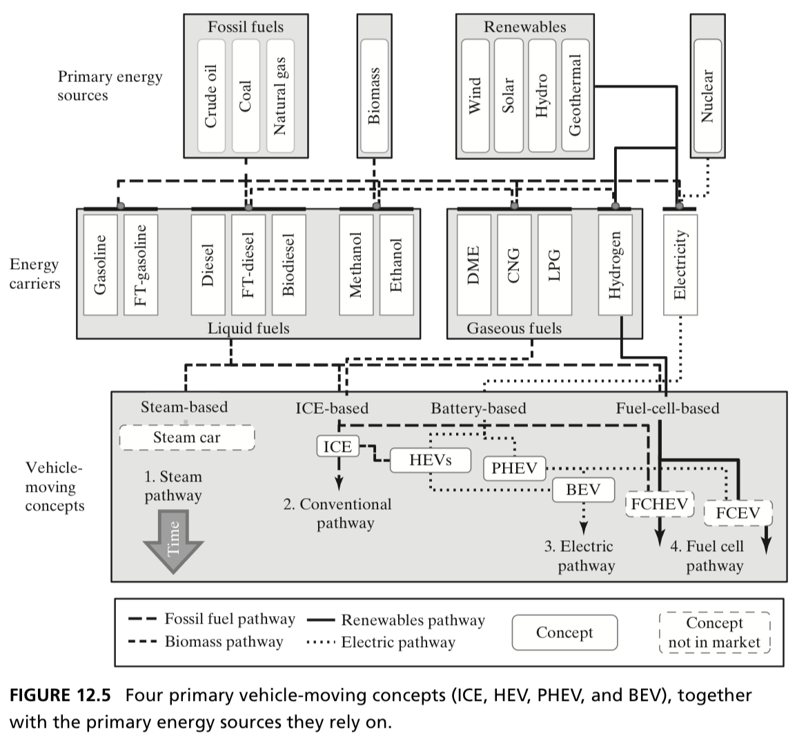](assets/chapter12/figure12-05.png)

**図12.5｜一次エネルギー源・キャリア・車両を動かすコンセプト。** 出典：[原著p.284](../ref/IMG_0049.png)。

同じ電動走行でも、電力を車外から蓄える場合と、車内で燃料からつくる場合がある。エネルギーの由来、運搬、変換、駆動を分けて考えることで、代替案を見つけやすくなる。

**原著の説明：** 蒸気と他方式の組合せ、火花点火／圧縮点火の内燃機関、電池、燃料電池を比較し、電池では寿命・エネルギー密度・コストが重要な論点とされる。〔pp.283–285〕

### 5.3 ハイブリッド車の7つの追加機能と断片

以下の7つは、推進の分解に加えて検討する内部機能である。各行を単なる機能名として読むだけでなく、**作用を実現する手段まで含めて**コンセプト断片として捉える。

| 番号・原語 | 何をするか／主な実現手段 | 顧客価値と統合上の論点 |
| --- | --- | --- |
| 1. 自動停止・再始動（Motor start-stop） | 停止時にエンジンを止め、必要時にモーターやスターター・ジェネレーターで再始動する | アイドリングの燃料を削減。再始動の速さや発進との連携が必要 |
| 2. 回生ブレーキ（Regenerative braking） | 駆動モーターを発電動作させ、減速時の運動エネルギーを電気として蓄える | 従来は熱として失われるエネルギーを回収。蓄電側の受入能力に制約がある |
| 3. ブースト（Power boost） | エンジンに加え、電池から給電したモーターでトルクを補う | 発進・加速・登坂などを支援。電池のエネルギーを消費する |
| 4. 負荷引上げ（Load level increase） | エンジンに発電負荷を加え、より効率の良い運転点を利用して電池などへ給電する | 走行に必要な負荷とエンジンの効率的な運転点を調整する |
| 5. 電動走行（Electric driving） | 電池に蓄えた電力でモーターを駆動する。エンジンを駆動系から切り離す | 電動走行を可能にする。蓄電量に制約があり、エンジンが発電用に動く場合もある |
| 6. 外部充電（External battery charging） | 充電装置などを介して車外の電力を受け入れる | PHEVを特徴づける。車両だけでなく充電環境へのアクセスが必要 |
| 7. 惰行（Gliding） | エンジンと電動系を車輪から切り離し、駆動系の抵抗を減らして惰行する | 惰行の利用を可能にする。必要に応じて適切な駆動系へ速やかに復帰する |

原著は惰行を、重力を利用する下り坂の走行を念頭に説明している。

### 5.4 エネルギーの向きを説明できるようにする

| モード | 主な流れ | 間違えやすい点 |
| --- | --- | --- |
| 回生 | 車両の運動 → モーターの発電 → 電池 | 外部からエネルギーが増えるわけではない |
| ブースト | 電池 → モーター → 車輪 | 回生と同じ機器でもエネルギーの向きが逆になる |
| 負荷引上げ | 燃料 → エンジン → 発電 → 電池や電装品 | 「負荷を増やすのに効率改善」というのは、エンジンの運転点の話 |
| 外部充電 | 車外の電力 → 充電装置 → 電池 | 回生やエンジンによる発電と、供給元が異なる |
| 電動走行 | 電池などの電源 → モーター → 車輪 | モーターで走ることと、エンジンが完全停止することは同義ではない |

この表は前節の作用を整理し直した補足。回生、ブースト、充電、走行が同じモーター・電池・制御を共有しうることが、統合時の相互作用につながる。

### 5.5 図12.6・12.7から何を読み取るか

**図12.6：燃料消費削減の寄与。** 原著のフルハイブリッドの例では、アイドリング削減が約5〜7%、制御の最適化が約5〜9%、回生が約5〜9%、全体が約15〜25%と示される。〔pp.285–286〕

<a id="figure12-06"></a>

[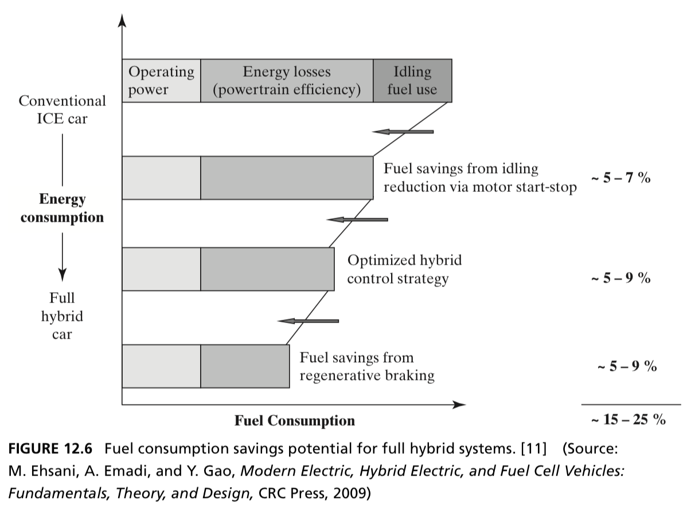](assets/chapter12/figure12-06.png)

**図12.6｜フルハイブリッドによる燃料消費削減の可能性。** 出典：[原著p.286](../ref/IMG_0051.png)。

これらは原著の条件付き概算であり、すべての車両に当てはめる数値ではない。本文は電動走行が限定的なフルハイブリッドを想定し、外部充電を含むPHEVを代表する値ではないと明記する。各範囲の端点を単純に加えて厳密な合計を導く読み方も避ける。

**図12.7：モーターとエンジンの特性を組み合わせる意味。** 縦軸はMoment、すなわちトルク、横軸は回転数。モーターは低回転域で大きなトルクを出し、図中の内燃機関とは特性が異なる。これが発進・加速時の補助を説明する。概念的な比較図であり、特定車種の測定値ではない。〔pp.286–287〕

<a id="figure12-07"></a>

[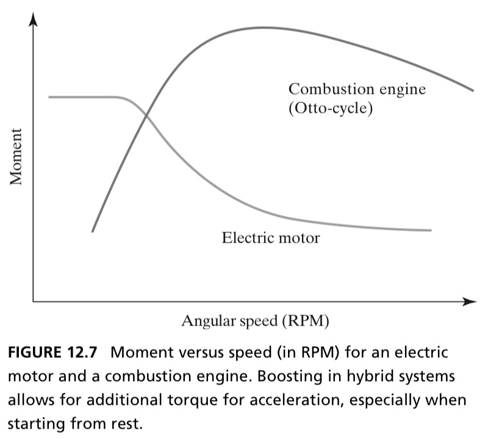](assets/chapter12/figure12-07.png)

**図12.7｜モーターと内燃機関のトルク・回転数特性。** 出典：[原著p.287](../ref/IMG_0052.png)。

**補足：** トルクと出力は別の量である。図の説明では「低回転でトルクを補う」と表現すれば、縦軸との混同を防げる。

### 5.6 分解の後に残る問い

断片を挙げたら、再び全体に戻る。

- 互いに同時使用できるか。
- 同じ部品を使い回せるか。
- 一方の機能が他方のための容量・接続・制御を要求しないか。
- 相乗効果は何か。どの組合せが競合するか。

たとえば、回生能力はモーターだけでなく蓄電側が受け入れられる電力に左右される。原著は、回生に適した短時間の大きな入出力と、持続的な電動走行とでは、蓄積装置に求める性質が異なることも説明する。〔12.4、pp.286–288〕

<a id="integrate"></a>

## 6. 12.5：断片から統合コンセプトをつくる

参照：[p.288](../ref/IMG_0053.png)／[p.289](../ref/IMG_0054.png)／[p.290](../ref/IMG_0055.png)／[p.291](../ref/IMG_0056.png)

### 6.1 再結合は、機能と形態の対応を変える作業

ステップ3では、エネルギーの貯蔵・運搬と車両の駆動、さらに7つの追加機能に関する断片を組み合わせ、統合コンセプトをつくる。各機能をどの形態に担わせ、どの経路で結びつけるかを探索する。

本章の事例は、組合せ探索の結果として代表的な統合案を示す。組合せを検討する全過程や、不成立の案を追跡する計算手法は、後のPart 4へ引き継がれる。

**補足：コンセプト断片は、独立した物理部品とは限らない。** 回生とブーストは別の断片だが、同じモーターを発電と駆動に使い分けて実現できる。機能を分けて考えた後に、形態を共有するか、分けるかを決めることも、統合時の設計判断になる。

### 6.2 シリーズ・パラレル・複合

| 構成 | 主な考え方 | 説明するときの着眼点 |
| --- | --- | --- |
| パラレル | 燃料側と電動側の駆動力を加える | エンジンもモーターも車輪を駆動する経路を持つ |
| シリーズ | 燃料側が電動側へ順にエネルギーを供給する | エンジンは発電に使い、モーターが車輪を駆動する |
| 複合 | 両方の性質を組み合わせる | 動力を分岐する方式や、モードを切り替える方式がある |

<a id="figure12-08"></a>

[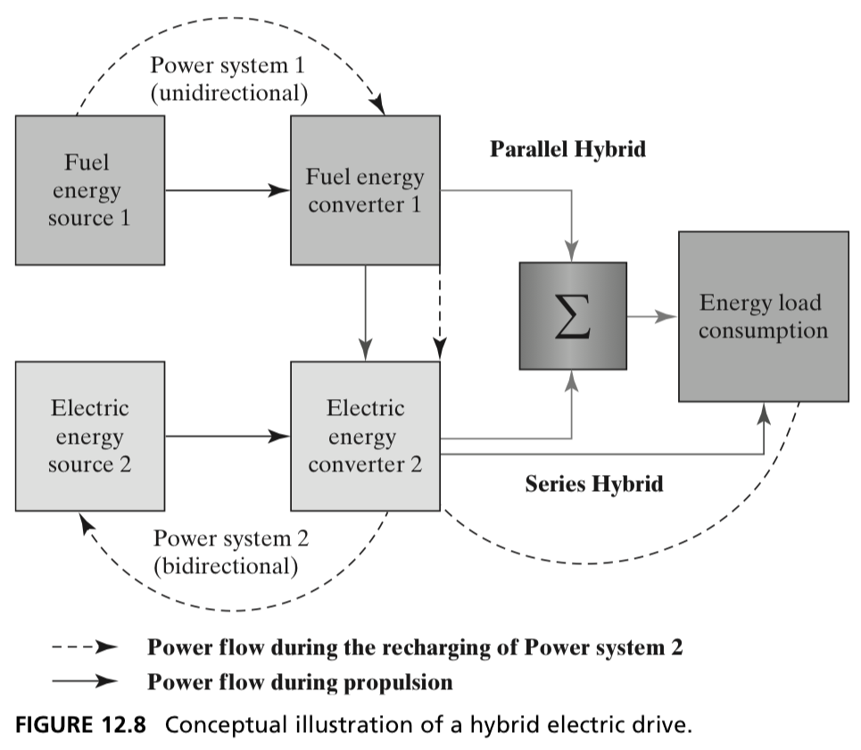](assets/chapter12/figure12-08.png)

**図12.8｜ハイブリッド駆動のエネルギー経路。** 出典：[原著p.289](../ref/IMG_0054.png)。

同じエンジン・電池・モーターを含んでいても、つなぎ方と役割の割当てが異なる。部品の有無だけでなく、経路を説明することがコンセプトの理解につながる。

### 6.3 解空間を2軸で捉える

図12.9では、次の2軸でコンセプト群を配置する。

<a id="figure12-09"></a>

[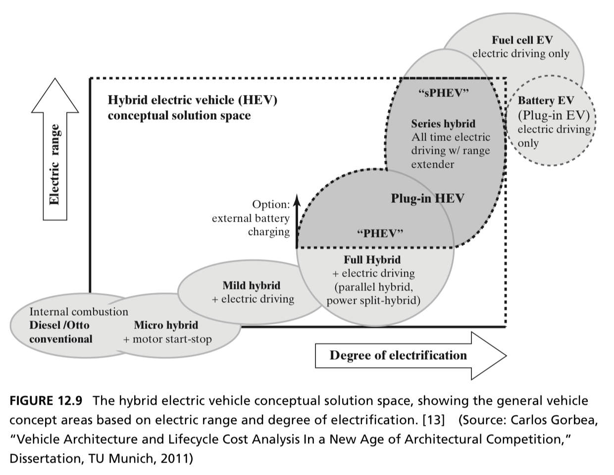](assets/chapter12/figure12-09.png)

**図12.9｜電動走行距離と電動化度で見るコンセプトの解空間。** 出典：[原著p.289](../ref/IMG_0054.png)。

| 軸 | 本章での意味 | 注意点 |
| --- | --- | --- |
| 電動走行距離（Electric range） | 電動推進によって走れる距離 | 電池容量だけでなく走行条件なども関わるため、単純な機器の有無とは異なる |
| 電動化度（Degree of electrification） | 電動機の合計ピーク出力を、電動機とエンジンの最大合計出力に対して捉えた比率 | エネルギーの何%を電気から得るかという比率ではない |

本章の定義を簡略に書くと、次のようになる。

```text
電動化度 ≒ 電動機の合計ピーク出力 ÷ 電動機とエンジンの最大合計出力
```

内燃機関車は0、内燃機関を搭載しないBEVは1と説明される。図12.9はカテゴリーが重なる概念図であり、数値目盛に従って厳密に分類する規格図ではない。〔pp.288–290〕

**補足：** 外部エネルギー源の数、駆動経路、電動化度、電動走行距離、外部充電の有無は別々の観点である。「PHEVだからシリーズ」「電動化度が1なら走行距離が同じ」とは言えない。

### 6.4 7つの統合コンセプト

以下は本章の分類・説明の要約。数値は本章が挙げる例である。

| 統合コンセプト | 本章での特徴 | 本章の数値例・構成 |
| --- | --- | --- |
| 従来型ICE | 車両の推進は内燃機関。電動推進はない | 電動化度0、電動走行距離0 |
| Micro HEV | 主に自動停止・再始動。推進は内燃機関のみ。一部に限定的な回生 | 電動単独走行はない |
| Mild HEV | 電動系による補助や回生。電動走行機能は限定的で、電動単独走行がないものも含む | 本章ではパラレル構成として説明 |
| Full HEV | より大きい電動系と短距離の電動走行。回生能力も増す | 電動化度10〜30%、電動走行距離500 m〜3 kmという例。主にパラレルまたは複合 |
| PHEV | 車外から電池を充電でき、電動走行距離を延ばす | 電動化度は典型的に35%超、距離5〜160 kmという例。シリーズ・パラレル・複合がある |
| BEV | 内燃機関を持たず、車外の電力を蓄えてモーターで走る | 電動化度1。HEVの領域の外側に位置づける |
| FCEV | 燃料電池で燃料から電力を得て、電動系で推進する | 主にシリーズ型として説明 |

**7つの追加機能と、7つの統合コンセプトは別のリストである。** 前者は全体案を構成する機能・実現原理、後者は組み上がった車両全体の候補カテゴリーである。

**読解のポイント：なぜハイブリッド車の検討に、ICEやBEVも入るのか。** 本章は車両全体の解空間へ比較を広げ、BEVをHEVの領域の外側に位置づけている。したがって、表に並ぶ全候補が、当初の「ガソリン／電気のハイブリッド車」というUsingをそのまま満たすわけではない。

**実務への解釈：** 当初のUsingを制約として固定するなら、その範囲で案を選ぶ。より上位の価値を満たす別方式まで採用候補にするなら、SPSを見直す。この区別を明示すれば、探索を広げることと、合意した問題を変えることを追跡できる。原著は各候補についてのSPS改訂内容までは示していない。

### 6.5 なぜ「良い断片を全部載せる」では足りないか

**解釈：** 電動走行を伸ばすために電池を大きくすれば、重量・コスト・搭載空間の別の目標と緊張が生じる。外部充電を加えると、車両外の利用環境も関わる。したがって、断片の価値を単独で評価するだけでなく、全体として機能が成立し、目標に合うかを確認する必要がある。

<a id="select"></a>

## 7. 12.6：少数の候補を選ぶ

参照：[p.291](../ref/IMG_0056.png)／[表12.1・p.292](../ref/IMG_0057.png)／[p.293](../ref/IMG_0058.png)

### 7.1 この段階では選択肢を保つ

候補が1つしかなければ、比較して選ぶことはできない。アーキテクトには、早期に1案へ集中したい圧力がある中でも、検討する価値のある選択肢を保持する役割がある。

一方で、コンセプト段階の情報は粗く、目標への適合を正確に評価できない。既知の案や詳細に説明された案が有利に見えることもある。著者は、思い出しやすさ、既存の信念への一致、情報量の多さ、なじみやアンカリングによる偏りを挙げ、判断を明示することを勧める。

### 7.2 後ろを見る評価と、前を見る評価

| 評価の向き | 何を見るか | 本章の例 |
| --- | --- | --- |
| Backwards-looking | これまでに定めた、優先順位のある目標への適合 | 環境面、航続距離、燃費、価格など |
| Forward-looking | 具体化したときに良いアーキテクチャになりそうか | 単純さ、機能と形態の対応、開発チームや製造工程との整合 |

時間の向きより、**上流の価値へ立ち返る評価／下流の具体化を見通す評価**と捉えると分かりやすい。

前を見る評価では、機能と形態が1対1か、より複雑な対応かを検討する例がある。ただし、本章は1対1なら自動的に最良とする判定式を与えていない。ある程度のアーキテクチャ定義を行い、反復して判断する必要がある。

### 7.3 Pughマトリクスとは

基準案を置き、各候補を複数の評価基準で比較する方法。本章の表12.1は**パラレル型フルハイブリッド**を基準に、5段階で定性的に比較する。

| 記号 | 基準案との比較 |
| --- | --- |
| `++` | 非常に有利 |
| `+` | いくらか有利 |
| `o` | 平均的・同程度 |
| `-` | いくらか不利 |
| `--` | 多くの不利がある |

本章は目標をCritically／Importantly／Desirablyに分けて示し、重要度に応じた重みづけも可能と述べる。ただし表自体には、数値の重みや集計した総合得点は示されていない。

### 7.4 表12.1：車両コンセプトの比較

原表を以下に掲載する。`HEV (Reference)`列がパラレル型フルハイブリッドの基準案である。

<a id="table12-01"></a>

[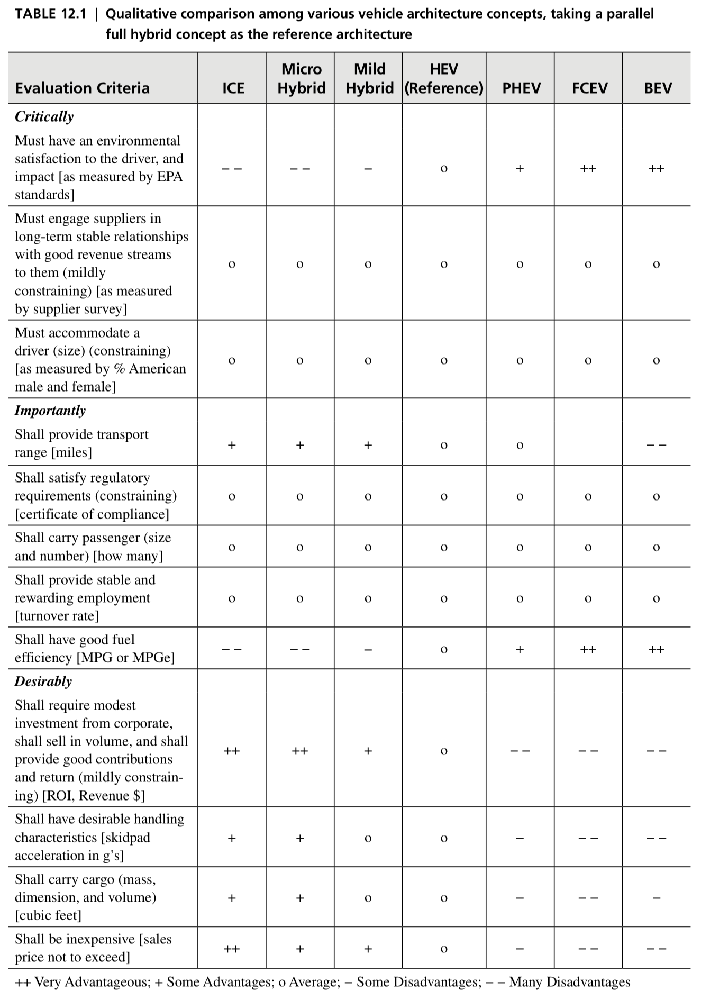](assets/chapter12/table12-01.png)

**表12.1｜車両コンセプトの定性的な比較。** 出典：[原著p.292](../ref/IMG_0057.png)。

**評価項目の読み替え：**

- **Critically（最重要）：** 環境面の満足・影響、供給者との長期安定関係・収益、運転者の身体寸法への適合。
- **Importantly（重要）：** 航続距離、規制要求への適合、乗員の収容能力、安定し報われる雇用、燃費。
- **Desirably（望ましい）：** 投資・販売量・企業収益、操縦性、荷物の搭載能力、購入価格の安さ。

FCEVの航続距離のセルは原表で空欄である。

**表と本文から読み取ること：** この例では電動化に環境面・燃費の利点があり、投資、重量、価格、航続距離などに課題がある。何を優先するかで判断は変わる。

表は相対的な長所と短所を示しており、最終順位や採用案は示していない。評価に使う場合は、優先目標、評価根拠、残る不確実性を併せて検討する。

**補足：比較表を読む順序。** たとえばPHEVは、この表でHEV基準より環境面・燃費が有利、購入価格・投資面が不利である。そこで、①優先する目標にどの利点が効くか、②その利点のためにどの不利を受け入れるか、③実際の使われ方でその利点が得られるか、の順に問いを立てる。PHEVなら、12.4で述べた充電環境へのアクセスも次の確認事項になる。

### 7.5 差がつかない目標の扱い

供給者との長期関係は重要でも、この粒度のコンセプトでは差を判断しにくい。著者は、この種の目標はコンセプトの違いより開発過程に関わる可能性があると述べる。

選別は、**重要で、かつ候補間に差を生む目標**を中心に行う。一方で、同じ評価の目標も、詳細化や開発段階での確認対象として残る。

**補足：** 表の`o`は基準との相対比較であり、要求の絶対的な達成を証明する記号ではない。未確認・判断不能と同程度も区別して記録すると、実務に使いやすい。

### 7.6 選別の出口

目標に照らした選別と、構成の単純さやまとまりの良さへの判断を経て、さらに開発する2〜3案を残す。必要なら定性的な比較に続けて定量比較を行う。評価法の詳細は本書のPart 4へ引き継がれる。

**解釈：** この段階の成果物は、案の名前だけでなく、残した理由、未確定の仮定、次の検証事項を添えると有用である。これは本章の判断を明示する姿勢を実務向けに具体化した提案である。

<a id="summary"></a>

## 8. 12.7：章全体のまとめ

参照：[p.293](../ref/IMG_0058.png)・[p.294](../ref/IMG_0059.png)

発想は、ひとつの問題から複数の全体案へ、さらに内部機能・断片へと展開する。再結合によって統合案を増やし、目標とアーキテクチャの観点で絞る。

<a id="figure12-10"></a>

[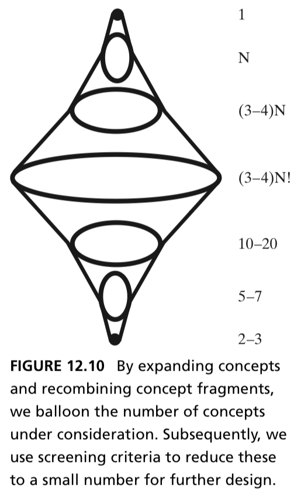](assets/chapter12/figure12-10.png)

**図12.10｜コンセプトの展開・再結合と段階的な選別。** 出典：[原著p.294](../ref/IMG_0059.png)。

原図は、1つの機能からN個の全体案へ、内部機能・断片とその組合せへと探索を広げ、定性的に10〜20案、定量的に5〜7案、最終的に2〜3案へ絞る流れを示す。これらの件数は、探索と絞り込みを説明する目安である。原図の組合せ数の表記については[14.1節](#sources)に補足した。

**章の接続：** コンセプト生成でも用いた分解を、次章では複雑性を管理する道具として使っていく。発想のための分解から、実装可能なシステムを構成するための分解へ進む。

<a id="competition"></a>

## 9. Box 12.2：自動車産業のアーキテクチャ競争

参照：[p.294](../ref/IMG_0059.png)／[p.295](../ref/IMG_0060.png)／[p.296](../ref/IMG_0061.png)／[p.297](../ref/IMG_0062.png)／[p.298](../ref/IMG_0063.png)

### 9.1 なぜ創造性の章の最後に産業史があるのか

この事例は、コンセプトの違いが製品の細部だけでなく、競争の土俵や必要な企業能力を変えることを示す。アーキテクチャ競争は、製品アーキテクチャの違いによる差別化をめぐる競争を指す。

### 9.2 初期の競争：蒸気・電気・内燃機関

3方式はいずれも「運転して移動する」という機能を担うが、構成要素、作動原理、利用条件が異なる。

| 方式 | 原著が述べる強み | 原著が述べる弱み |
| --- | --- | --- |
| 蒸気 | 発進時の力、加速性能、蓄積された蒸気機関の技術 | 水の補給、始動準備、価格や重量 |
| 電気 | 操作が簡単、保守の負担が小さい、走行時の不快な排出が少ない | 当時の電池のエネルギー密度、速度・航続距離、電力へのアクセス |
| 内燃機関 | 後に量産による価格低下と始動の改善を達成 | 初期には手回し始動の危険などがあった |

図12.11の広告は、技術性能だけでなく、使いやすさや想定顧客像を通じても差別化していたことを示す。原著の性別による顧客の記述は当時の販売訴求の説明として読む。

<a id="figure12-11"></a>

[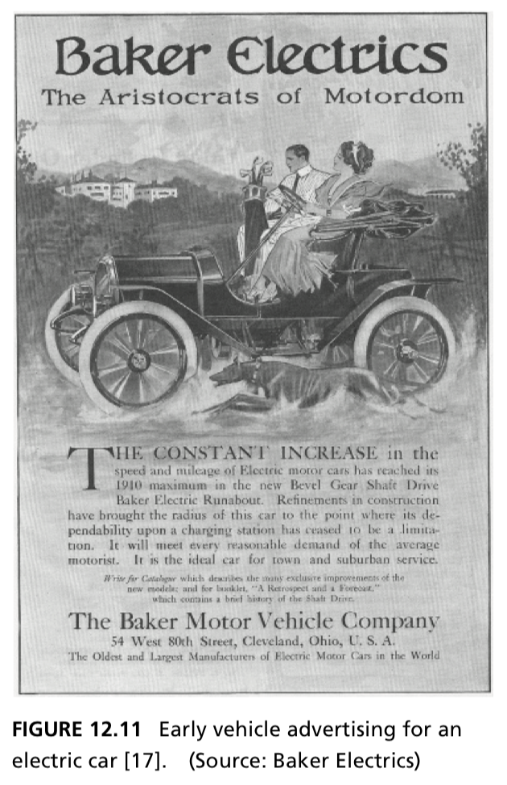](assets/chapter12/figure12-11.png)

**図12.11｜初期の電気自動車の広告。** 出典：[原著p.295](../ref/IMG_0060.png)。

### 9.3 内燃機関の支配を説明する2つの変化

著者が重視するのは、**組立ラインによる価格低下**と**電動スターターによる始動の改善**である。単一の性能で優劣が決まるのではなく、価格、使い勝手、利用条件の組合せが大きく変わった。

蒸気車側も凝縮器などで弱点の解消を図ったが、重量と価格が増す問題があったと説明される。改善のための機能追加が、別の評価軸を悪化させる例として読める。

### 9.4 支配的なアーキテクチャが組織を方向づける

内燃機関という基本構成が定着すると、企業は全体構成の選択より、既存のサブシステムの改良に集中できる。組織や中核能力も、その構成を前提に発達する。

しかしアーキテクチャ競争が再び強まると、過去に有利だった組織構造や専門能力だけでは対応しづらい。著者は既存企業にも適応が必要になると論じる。〔pp.296–298〕

### 9.5 図12.12の読み方

<a id="figure12-12"></a>

[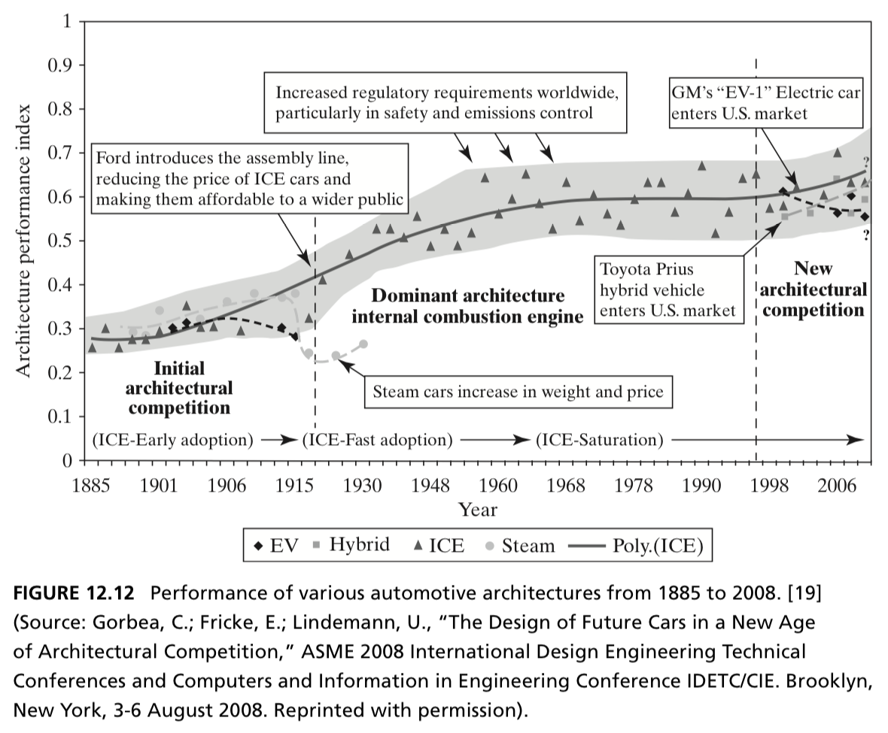](assets/chapter12/figure12-12.png)

**図12.12｜1885〜2008年の自動車アーキテクチャの性能推移。** 出典：[原著p.297](../ref/IMG_0062.png)。

- 横軸は1885〜2008年、縦軸はArchitecture performance indexである。
- 初期のアーキテクチャ競争、内燃機関の支配、競争の再開という3つの時期を示す。
- **縦軸は市場シェアではない。** 値の差をそのまま販売比率として読まない。
- 本章の「現在」「将来」は執筆時点の表現であり、図の1998〜2008年の局面を含めて読む。

この章は「内燃機関は蒸気車と同じ道を歩むのか」「かつて敗れた電気自動車は再び勝者になれるのか」という、執筆当時の問いを残して結ばれる。

**解釈：** コンセプトの選択は、製品内の技術と、製造・利用環境・組織能力を一緒に方向づける。そのため、多様な全体案を比較できることが戦略上の意味を持つ。

<a id="glossary"></a>

## 10. 用語集

| 原語・略語 | この資料での訳・意味 | 見分けるポイント |
| --- | --- | --- |
| System concept | システムコンセプト | 機能と形態をつなぐアイデア・作動原理 |
| Function | 機能 | 何をするか |
| Form | 形態・実現手段 | 外見だけでなく、機能を担う実体や構成を指す |
| Operand | 作用の対象 | 変化を与えられる人・物・エネルギーなど |
| Process | 作用・過程 | 対象にどのような変化を与えるか |
| Instrument | 手段 | その作用を実行するもの |
| Solution-neutral | 解決手段に依存しない | 特定の実装を前提にせず、必要な価値・作用を表す |
| Solution-specific | 解決手段を具体化した | 運転、発電など、選んだ手段に即した作用 |
| SPS | System Problem Statement：システム問題記述 | 目的・作用・実現手段と目標を共有する出発点 |
| To–By–Using | 目的・作用・手段を整理する枠組み | 何のために／どうすることで／何を用いて |
| Concept fragment | コンセプト断片 | 全体案の一部をなす、機能と実現手段の対応 |
| Integrated concept | 統合コンセプト | 断片を整合させた全体の案 |
| Component recombination | 要素の再結合 | 分けた要素の代替案を組み直して発想する |
| Completeness framework | 網羅性を促す枠組み | 一覧や視点の切替えで考え漏れを減らす |
| Morphological matrix | 形態マトリクス | 機能ごとの実現候補を並べ、組み合わせる表 |
| OPM | Object Process Methodology | 対象と作用の関係を扱う表現。本章はこれだけに依存せず、領域固有の言葉・方法を使う |
| ICE | Internal Combustion Engine | 内燃機関。文脈により従来型の内燃機関車も指す |
| HEV | Hybrid Electric Vehicle | 電動系を組み合わせたハイブリッド車 |
| PHEV | Plug-in Hybrid Electric Vehicle | 外部充電が可能なハイブリッド車 |
| BEV | Battery Electric Vehicle | 電池の電力で推進する電気自動車 |
| FCEV | Fuel Cell Electric Vehicle | 燃料電池から得る電力で推進する電気自動車 |
| Down-selection | 絞り込み・選別 | 候補を比較し、次に検討する少数案を残す |
| Pugh matrix | Pughマトリクス | 基準案に対する相対評価を複数基準で整理する |
| Architectural elegance | アーキテクチャの洗練・まとまりの良さ | 単純さや機能・形態の対応などから判断する。本章に万能な数式はない |
| Architectural competition | アーキテクチャ競争 | 異なる全体構成による差別化をめぐる競争 |

<a id="figures"></a>

## 11. 図表の読み解き一覧

図表名を押すと、本文に貼り込んだ原図・原表へ移動する。

| 図表 | ページ・原画像 | 説明すべきこと | 避けたい読み違い |
| --- | --- | --- | --- |
| [図12.1](#figure12-01) | [277](../ref/IMG_0042.png) | 曖昧さの低減、創造性の適用、複雑性の管理をつなぐ | コンセプトだけを独立して考える |
| [図12.2](#figure12-02) | [278](../ref/IMG_0043.png) | 発想で候補を広げ、目標への適合で絞る | 最初から1案に収束させる |
| [図12.3](#figure12-03) | [279](../ref/IMG_0044.png) | 機能ごとの形態候補を再結合する | すべての組合せが実現可能だと思う |
| [図12.4](#figure12-04) | [280](../ref/IMG_0045.png) | 機能から形態への対応がコンセプト | コンセプトを属性や部品名だけで説明する |
| [図12.5](#figure12-05) | [284](../ref/IMG_0049.png) | 一次エネルギー、キャリア、駆動方式を分けて結びつける | 電力や水素を一次エネルギー源と混同する |
| [図12.6](#figure12-06) | [286](../ref/IMG_0051.png) | 複数の内部機能が燃料消費削減に寄与する | 削減率をあらゆるHEV・PHEVへ適用する |
| [図12.7](#figure12-07) | [287](../ref/IMG_0052.png) | トルク特性の違いを組み合わせる | トルクのグラフを出力のグラフとして説明する |
| [図12.8](#figure12-08) | [289上](../ref/IMG_0054.png) | シリーズとパラレルのエネルギー経路の違い | 同じ部品があれば同じ構成だと思う |
| [図12.9](#figure12-09) | [289下](../ref/IMG_0054.png) | 電動走行距離と電動化度で解空間を広く見る | 厳密な分類境界・必ず通る技術進化の順序と読む |
| [表12.1](#table12-01) | [292](../ref/IMG_0057.png) | 基準案と評価基準を明示して相対比較する | 得点合計や最終採用案を勝手に導く |
| [図12.10](#figure12-10) | [294](../ref/IMG_0059.png) | 分解・再結合で拡大し、少数案へ絞る | 候補件数や階乗表記を一般的な計算規則にする |
| [図12.11](#figure12-11) | [295](../ref/IMG_0060.png) | 初期EVの広告が顧客価値の訴求を示す | 広告の主張を性能の実測結果とみなす |
| [図12.12](#figure12-12) | [297](../ref/IMG_0062.png) | 競争、支配、競争再開という産業の局面 | 縦軸を市場シェアと読む |

発表で時間が限られる場合は、図12.1、図12.8、表12.1、図12.10の4つを中心にすると、章の位置づけ・事例・選別・全体の流れをつなげやすい。

<a id="questions"></a>

## 12. 理解確認と解答

まず解答を見ずに、自分の言葉で30秒ずつ説明する。

### 問い

1. 「環境に優しい車」と「モーターを発電動作させ、減速時のエネルギーを電池へ回収する車」では、コンセプトの具体性がどう違うか。
2. 分析や手順から生まれたアイデアも、なぜ本章では創造性に含まれるのか。
3. 外部充電をしないHEVが、エンジンと電池を積んでいてもmonovalentになるのはなぜか。
4. 7つの追加機能と7つの統合コンセプトは、どう違うか。
5. シリーズ型とパラレル型を、部品名だけでなくエネルギー経路で説明できるか。
6. Backwards-lookingとforward-lookingの評価を、1つずつ例示できるか。
7. 表12.1で全案が同じ評価の目標を、なぜ削除すべきとは限らないのか。
8. Chapter 12の出口を「最終的な1案の確定」と説明すると、何を取り落とすか。
9. 電動化度が1のBEV同士なら、電動走行距離も同じになるか。
10. アーキテクチャ競争は、なぜ既存企業の組織能力に関わるのか。
11. 回生とブーストを別のコンセプト断片として扱うと、それぞれに専用部品が必要になるか。
12. 当初のSPSがハイブリッド車を指定している場合、BEVを採用候補にするときに何を確認する必要があるか。

<details>
<summary>解答の要点を開く</summary>

| 問い | 答えの要点 |
| --- | --- |
| 1 | 前者は目標・属性。後者は回収という機能と、モーター・蓄電系という実現手段を結びつけている |
| 2 | 創造性を無意識のひらめきに限定せず、意図的な努力や分析による新しい結びつきも認めるため |
| 3 | 車外から受け取るのは燃料だけで、電池は内部の蓄積手段だから。機器の数と外部供給源の数は違う |
| 4 | 前者は断片として組み込む内部機能と実現原理。後者はそれらを統合した車両全体の候補群 |
| 5 | シリーズは燃料→エンジン→発電→モーター→車輪。パラレルはエンジンとモーターの駆動力が合流する |
| 6 | 後ろを見る：目標の航続距離への適合。前を見る：構成を単純にでき、開発チームや製造工程に割り当てられるか |
| 7 | 現在の粒度で差が見えないだけかもしれず、開発過程や詳細設計で満たす必要があるため |
| 8 | 選択肢を保持し、2〜3案をより詳しい検討へ進めるという狙いを失う |
| 9 | 同じにならない。出力比率と走行距離は別の指標であり、電池容量なども異なりうる |
| 10 | 支配的な構成に合わせて専門能力と組織分担が形成され、新しい全体構成への移行で再適応が必要になるため |
| 11 | 必ずしも専用部品は必要ない。同じモーターなどを複数の機能で共有でき、共有するか分けるかも統合時の判断になる |
| 12 | ハイブリッド車というUsingを固定制約とするか、上位の価値に立ち返ってSPSを見直すかを明示する |

</details>

<a id="worksheet"></a>

## 13. 自分の仕事に適用するワークシート

**補足・演習：** 本章の枠組みを実務に移すための記入欄。原著の様式を転記したものではない。

### A. 目的と探索範囲を置く

| 項目 | 記入欄 |
| --- | --- |
| 誰にどんな価値を届けたいか |  |
| 解決手段に依存しない対象と作用 |  |
| To：何を達成するか |  |
| By：どんな作用によって達成するか |  |
| Using：何を用いる案か |  |
| 優先する目標と理由 |  |
| 固定する制約／再検討できる目標 |  |
| 現時点で前提にしている解決手段 |  |

### B. 機能ごとに複数の実現候補を出す

| 内部機能 | 形態・原理の候補A | 候補B | 候補C | 他機能との依存・競合 |
| --- | --- | --- | --- | --- |
| 機能1 |  |  |  |  |
| 機能2 |  |  |  |  |
| 機能3 |  |  |  |  |

各候補は「部品名」だけでなく、「何をどう変えるか」まで書く。次に各行から候補を選び、接続と作用を説明できる全体案を複数つくる。不成立の組合せは理由を残す。

### C. 断片を全体案へ組み上げる

| 項目 | 統合案A | 統合案B |
| --- | --- | --- |
| 選んだ機能ごとの候補 |  |  |
| 対象・エネルギー・情報の主な流れ |  |  |
| 複数機能で共有する手段 |  |  |
| 必要な接続・制御・役割分担 |  |  |
| 成立条件と、競合する組合せ |  |  |

全体案を1〜2文で説明する。選んだ部品の一覧に加え、どのように連携して価値を実現するかを書く。

### D. 比較して次の検証を決める

| 評価項目 | 基準案 | 案A | 案B | 判断の根拠・不確実性 |
| --- | --- | --- | --- | --- |
| 優先目標1への適合 |  |  |  |  |
| 優先目標2への適合 |  |  |  |  |
| 構成の単純さ・機能の割当て |  |  |  |  |
| 開発・製造などとの整合 |  |  |  |  |

案の詳細度をそろえ、情報不足を不利な性能評価と混ぜない。残す案ごとに、次に何を調べれば判断が変わるかを書く。

<a id="sources"></a>

## 14. 読解上の注意・原資料索引

### 14.1 原文を読む際の補足

| 箇所 | 注意と資料での扱い |
| --- | --- |
| p.283のbivalentへの言及 | 本文は元のコンセプトがbivalentに固定されていたと述べる。一方、p.282のSPSには外部充電を明記していない。「ハイブリッド」という名称だけで外部エネルギー源の数を断定せず、定義と個別構想を分けて説明する |
| pp.284–285の市場・将来予測 | 「燃料電池は市場準備まで数十年」などは当時の記述。現時点の事実として引用しない |
| 図12.5の範囲 | キャプションはICE・HEV・PHEV・BEVを挙げる一方、図全体には蒸気・燃料電池の経路も載る。本資料は図全体の層構造を説明した |
| pp.286–287のトルクと出力 | 本文には回転数と最大出力に触れる説明もあるが、図12.7の縦軸はMoment。発表ではトルク特性の比較として説明する |
| p.290のMild HEVなど | 本章固有の分類と数値例として扱う。カテゴリー名が現在のすべての製品仕様を保証するとはしない |
| p.291冒頭のBEVの走行距離 | 本文は走行距離と搭載された電動化の水準を結びつけて述べるが、直前の定義ではBEVの電動化度は1。したがって、その出力比率だけから航続距離を導かない |
| 表12.1 | 記号による相対評価で、総合点や採用案は示さない。FCEVの航続距離欄は原表で空欄。環境評価をライフサイクル全体の排出量比較と同一視しない。p.293の説明はtank-to-wheelの排出低減に言及する |
| pp.293–294の組合せ数 | 原文・図には`(3–4)N!`という表記がある。探索の急拡大を表すものとして紹介し、階乗を一般的な候補数の公式にはしない |
| 図12.12 | 1885〜2008年を対象とする性能指数の図。市場シェアや現在の優劣を示すものとして扱わない |
| p.295の広告への説明 | 本文は左右2つの広告に言及するが、提供画像で図12.11として確認できるのはBaker Electricsの広告1点。未掲載の広告を見たものとして説明しない |

**補足：組合せ数を自分の問題で数えるなら。** 機能ごとに候補を1つずつ選び、選択が独立なら、候補数は各行の候補数の積になる。たとえば3機能に各3候補なら`3 × 3 × 3 = 27`。これは本資料の説明例であり、原著の件数の導出ではない。実際には制約、不成立の組合せ、重複を考慮する。

### 14.2 原資料のページ対応

参照元はすべてユーザー提供の画像。第1画像にはページ番号の表示がないため、以降の連番からp.276相当とした。

| 原著ページ | 元画像 | 主な内容 |
| --- | --- | --- |
| 276相当 | [IMG_0041](../ref/IMG_0041.png) | 章扉、12.1 Introduction |
| 277 | [IMG_0042](../ref/IMG_0042.png) | 図12.1、12.2節の冒頭、創造性 |
| 278 | [IMG_0043](../ref/IMG_0043.png) | 図12.2、非構造化の創造性 |
| 279 | [IMG_0044](../ref/IMG_0044.png) | 構造化された創造性、図12.3 |
| 280 | [IMG_0045](../ref/IMG_0045.png) | TRIZ、コンセプトの定義、図12.4 |
| 281 | [IMG_0046](../ref/IMG_0046.png) | Box 12.1、4ステップの前半 |
| 282 | [IMG_0047](../ref/IMG_0047.png) | 4ステップの後半、12.3、SPS |
| 283 | [IMG_0048](../ref/IMG_0048.png) | 12.4、外部エネルギー源による分類 |
| 284 | [IMG_0049](../ref/IMG_0049.png) | 図12.5、エネルギーと駆動方式 |
| 285 | [IMG_0050](../ref/IMG_0050.png) | 追加機能、自動停止・再始動、回生 |
| 286 | [IMG_0051](../ref/IMG_0051.png) | 図12.6、回生、ブースト |
| 287 | [IMG_0052](../ref/IMG_0052.png) | 図12.7、負荷引上げ、電動走行、外部充電、惰行 |
| 288 | [IMG_0053](../ref/IMG_0053.png) | 12.5、統合と駆動経路 |
| 289 | [IMG_0054](../ref/IMG_0054.png) | 図12.8・12.9 |
| 290 | [IMG_0055](../ref/IMG_0055.png) | 電動化度、統合コンセプトの分類 |
| 291 | [IMG_0056](../ref/IMG_0056.png) | BEV・FCEV、12.6、選別とPughマトリクス |
| 292 | [IMG_0057](../ref/IMG_0057.png) | 表12.1 |
| 293 | [IMG_0058](../ref/IMG_0058.png) | 評価の考え方、12.7 Summary |
| 294 | [IMG_0059](../ref/IMG_0059.png) | 図12.10、Box 12.2の冒頭 |
| 295 | [IMG_0060](../ref/IMG_0060.png) | 図12.11、初期の競争 |
| 296 | [IMG_0061](../ref/IMG_0061.png) | 初期の各方式、内燃機関の支配 |
| 297 | [IMG_0062](../ref/IMG_0062.png) | 図12.12、競争の再開 |
| 298 | [IMG_0063](../ref/IMG_0063.png) | Box 12.2の結び、参考文献1〜15 |
| 299 | [IMG_0064](../ref/IMG_0064.png) | 参考文献16〜19 |

### 14.3 深掘りするときの文献の手がかり

以下は**原著の参考文献欄に挙がる文献**であり、この資料のために直接読んで検証した文献ではない。書誌の詳細は[p.298](../ref/IMG_0063.png)・[p.299](../ref/IMG_0064.png)を参照。

| 本章の文献番号 | 文献 | 関心との対応 |
| --- | --- | --- |
| [1] | R. W. Weisberg, *Creativity: Understanding Innovation in Problem Solving, Science, Invention, and the Arts*（2006） | 創造性の捉え方 |
| [3] | E. De Bono, *Six Thinking Hats*（1989） | 視点を変える構造化手法 |
| [11] | M. Ehsaniほか, *Modern Electric, Hybrid Electric, and Fuel Cell Vehicles: Fundamentals, Theory, and Design*（2009） | ハイブリッドの内部機能 |
| [13] | C. Gorbea, *Vehicle Architecture and Lifecycle Cost Analysis in a New Age of Architectural Competition*（参考文献欄は2011） | 車両の解空間とライフサイクル費用 |
| [14] | M. Bazerman and D. A. Moore, *Judgment in Managerial Decision Making*（2012） | 判断の偏り |
| [16] | R. M. Henderson and K. B. Clark, “Architectural Innovation: The Reconfiguration of Existing Product Technologies and the Failure of Established Firms”（1990） | アーキテクチャの変化と既存企業 |
| [19] | C. Gorbea, E. Fricke, U. Lindemann, “The Design of Future Cars in a New Age of Architectural Competition”（2008） | 図12.12と産業の競争局面 |

章扉の謝辞ではGorbeaの研究に2012年と記載があり、参考文献[13]および図12.9では2011年と記載される。この資料では参考文献欄の表記を示し、版・刊行形態の差までは推定していない。
